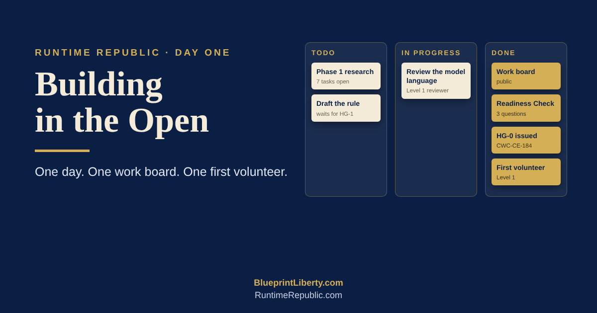

# Day One: Building in the Open

**November 1, 2026** · PRJ-002, the Kansas One-Hour Posting Rule

This morning, the One-Hour Rule was an idea, a set of essays, and a plan on paper. By supper, a volunteer was reading the draft.

Here's how one day got us there.

**It started with a small problem.** Our lessons had pictures sitting next to the text, and the pictures made each course too big to hand to an AI assistant in one piece. So we moved every picture into its own folder. The lessons still show their images, but now a whole course can be loaded into Claude in one click. It sounds small. But if we want ordinary people to learn this with an AI at their side, the lessons have to fit.

**Then we decided who does what.** I make the decisions. Claude plans the work and checks it. Cursor, an AI that edits our files, carries out the work. Every job gets a number, and every job ends with a written report. Before the day was over we'd done eleven of them, and Claude read every result before I approved it. Twice, Cursor stopped and said, "This doesn't match the work order." Both times it was right. A rule that stops the machine when something looks wrong is a rule worth having.

**Next, we built a public work board.** It lists every task between today and November 30: the research, the decisions, and the drafting. Anyone can see it. Nobody's phone number or address is on it. When someone signs up to help, their sign-up appears on the board by itself.

**Then we built a quiz, and I failed it.** I mean that honestly. The first version had twenty-eight questions on seven lessons. I sat down to take it myself and couldn't finish. So we threw it out. The new one asks three things: what a "gut and go" is, why it hurts ordinary Kansans, and why the One-Hour Rule ends secret action on bills. Then it asks whether you support the goal, and there's no wrong answer to that one. That's the lesson of the day: test everything on yourself first.

**Then I issued the first work card.** It's called HG-0, and it opens the first phase of research. Seven research tasks are now open: mapping the constitution, the joint rules and the statutes this would touch, defining words like "version" and "posted," and checking every citation. No bill text gets written yet. We engineer first and draft second.

**Then we invited someone.** One link, sent by Messenger. Our first volunteer said yes. He made a GitHub account, read the lessons, opened his onboarding page, and passed the quiz. He also left an honest concern: one hour might not be long enough. That's exactly the kind of thing we want to hear.

Along the way he got stuck on a screen asking for permissions, and that taught us something too. Every step a newcomer takes should leave a public breadcrumb, a checked box or a short note, so his own AI assistant can read it and tell him where he stands. By evening, his Claude could do just that: you're Level 1, here's the document, start with question four.

**And then he got the draft.** It's the model language for the One-Hour Rule: a joint rule, a statute and a constitutional amendment, written in plain words, with every clause numbered so reviewers can comment on it one piece at a time. He can comment, but he can't change a word. He proposes, and I decide.

**We also wrote rules for the next people.** The levels go Reviewer, then Contributor, then Proposer, and you climb by doing good work. When I wanted to move our first volunteer straight to the top, we talked it through and chose not to. Everyone climbs the same ladder. The next volunteer should see a fair process, not a favor.

Here's what struck me most. Everything we did today is something we're asking the Kansas Legislature to do. Every change is public. Every step is signed and dated. Nothing that matters happens in a back room, and there's a clear line between those who propose and the one who decides. We're writing the One-Hour Rule the way we believe every bill should be written.

Let's recap. In one day we made our lessons easy to use with AI, set up a numbered and checked way to get work done, built a public work board, made a quiz people can actually pass, opened the research phase, and welcomed our first reviewer. The draft is due November 30.

If you want to help, you don't need to be a lawyer or a programmer. Start with the free lessons and the [onboarding page](../ONBOARDING.md), and we'll take it one step at a time.

No bill in the dark.

*— James A. Hodges, Human Engineer*

BlueprintLiberty.com · RuntimeRepublic.com
