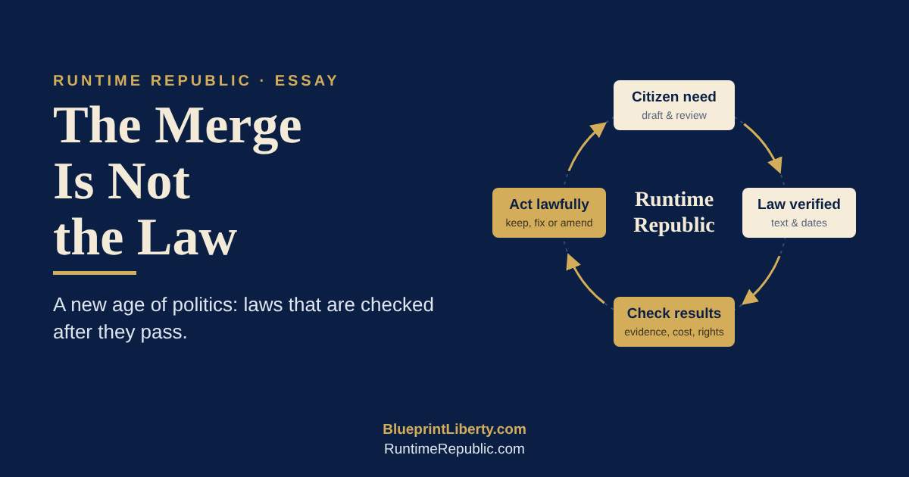

# The Merge Is Not the Law: A New Age of Politics

**November 2, 2026** · An essay on the proposed [Legislative Lifecycle and Continuing Statutory Improvement Control](https://github.com/RuntimeRepublic/Constitutional-Engineering/blob/c0986d6c92e610b857a490e0a593b1c2f067b8a4/proposals/runtime-republic-legislative-lifecycle-control-draft.md) (draft 0.1, pending review), with PRJ-002 as its first test case

**The old age ends at the vote.** For most of our history, politics has had a finish line. A bill passes, a governor signs, a press release goes out, and everyone moves on to the next fight. Whether the law did what it promised is rarely anyone's job.

Citizens feel this gap even if they cannot name it. A tax relief bill is celebrated, yet the bill in the mailbox keeps climbing. A transparency rule is adopted, yet the documents still appear minutes before the vote. The ceremony was real. The result was never checked.

That is the old age of politics: campaigns, slogans and roll calls, judged by who won rather than by what worked. A new age begins when we stop treating passage as the end of the story and start treating it as the moment a law goes live.

**The goal is a Runtime Republic.** That means a government judged by how it actually runs, not by what it announced. The phrase comes from software. Code that compiles is not finished; it has to run, be watched, and be fixed when it fails. Law is the same.

The foundation is old. Government exists to secure the life, liberty and property of its citizens, and nothing more. Every control document, from the U.S. Constitution to a school board charter, has one job: to list what government may do, rather than leave it open-ended power. That is why words like taxpayer-supremacy are chosen on purpose. The citizen is sovereign; the government is the hired system.

What is new is the method. If government is a system the people built, the people should be able to inspect it, measure it and correct it. That idea applies at every level, from the nation to the county to the school district.

**The tool is a lifecycle, not a finish line.** The Legislative Lifecycle and Continuing Statutory Improvement Control is a proposed draft, written November 2, 2026, and still waiting for review. It follows a proposal from a citizen's need, through drafting and the official decision, into implementation, evidence and lawful improvement. Then it loops back.

The loop is the whole point. A proposal that fails is recorded and either revised or closed. A law that passes is checked against what it promised. A law that falls short goes back to drafting, through the same lawful process, as a new and linked proposal.

Three things make it a real tool rather than a slogan:

- **A permanent law record.** Each law gets a stable ID that outlives session bill numbers, with every version, effective date and amendment linked to the one before it.
- **Checks planned before the law runs.** Every material requirement gets a row: the exact provision, what it legally requires, how it will be measured, the baseline, the expected result, the cost and burden, and who owns the evidence.
- **A Plan-Do-Check-Act cycle after enactment.** Results, costs, taxpayer burden, rights impacts and unintended effects are reviewed on a schedule, and each decision is recorded with its evidence and reasons.

The draft puts one warning bluntly: more forms, more spending, or a new dashboard is not the promised outcome. That single sentence would retire half the press releases in any capitol.

**Honesty is an engineering discipline.** The most radical feature of this control is not technical. It is a set of rules that forbid flattering the record.

A chamber vote, a signature or a GitHub merge does not prove a law is in force; publication and effective dates must be verified for each provision. A missing timestamp is unknown evidence, not a violation. A baseline is never invented after the fact. A before-and-after change does not prove the law caused it. A missed review is overdue, not quiet approval. Failed proposals and negative findings are kept as lessons, not deleted.

Old politics runs on the opposite habits: claim the win early, bury the miss, blame the other side. An engineer cannot work that way, because a system that lies about its own state cannot be fixed. Bringing that discipline into civic life is what makes this a new age rather than a new slogan.

**Power stays in its lane.** A movement that preaches limited powers has to practice them. This control does. It grants itself no power to review, enforce, repeal or sunset any law. Governmental decisions stay with the institutions the Kansas Constitution names: [Article 2](https://www.sos.ks.gov/publications/kansas-constitution/kansas-constitution-article-2.html) for enactment, veto and publication, and [Article 14](https://www.sos.ks.gov/publications/kansas-constitution/kansas-constitution-article-14.html) for amendments that only the voters can approve.

The same limit binds the machines. Automations may gather evidence, flag problems and prepare review packages, but they cannot enact law, certify compliance, approve changes or grant authority. A human engineer accepts the work. Citizen reports can open an investigation, but only official records establish what the law is.

That is the deeper lesson of the new age. Technology does not replace self-government; it gives citizens better instruments for watching the government they already have. The project practices the restraint it asks of the state.

**PRJ-002 is the first test.** It is small on purpose. PRJ-002, the Kansas One-Hour Posting Rule, asks a plain question: can citizens see the exact text of legislation before lawmakers act on it?

The control turns that question into checks anyone could audit. Can a reviewer identify the exact version being considered? How much time separates verified public posting from the official action? Can a replacement text be linked to the one before it? Are comments tied to a clause and given a recorded answer? What does compliance cost staff and citizens?

Notice what the checks do not ask. They do not judge whether a bill is good or bad; they ask whether the process was open. That makes the work nonpartisan by design. And it is honest about its stage: the drafting is observed now, while checks after adoption wait until there is a real rule in force to measure.

Politics is the art of associations, and this is where the tool meets people. Volunteers train, earn their level, and draft together in the open, with every change on the record. The repository becomes a town hall that keeps minutes.

**Citizens become maintainers of their law.** The new age of politics will not be announced. It will arrive one checked provision at a time, when citizens stop asking only "Did it pass?" and start asking "Is it working, and how do we know?"

In that age, a citizen is not just a voter or a donor. A citizen is a maintainer: someone who reads the text, watches the results, reports a problem with evidence, and proposes the smallest lawful fix. Government stays limited because the people keep measuring it against its purpose.

The Runtime Republic is the goal. The lifecycle control is the tool. And the first rule of both fits in five words: the merge is not the law.

*— James A. Hodges, Human Engineer*

BlueprintLiberty.com · RuntimeRepublic.com
