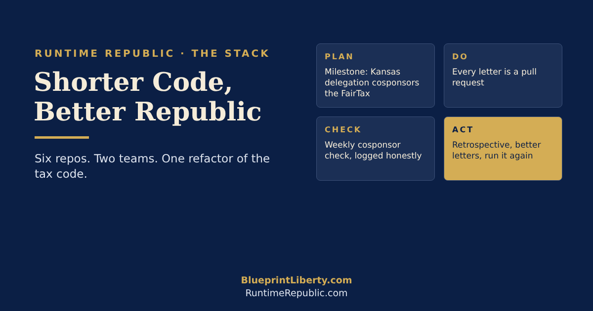

# Shorter Code, Better Republic: What We're Shipping at Runtime Republic

**November 4, 2026** · RuntimeRepublic org

Justin Steubs ([@justinsteubs](https://x.com/justinsteubs)), who just joined our national team, made a point this week that any programmer will recognize: most "tax reform" makes the code longer. H.R. 25, the FairTax, deletes code instead. No income tax, no payroll tax, no individual returns.

That's the whole idea behind [Runtime Republic](https://github.com/RuntimeRepublic): treat law like software. Version it, review it, test it, and ship it in public. Here's what we're building on GitHub, and how the FairTax becomes our first live deployment.

## The stack

The RuntimeRepublic org is a civic tech stack, one repo per job:

| Repo | What it does |
| --- | --- |
| [AGCL-Control-Documents](https://github.com/RuntimeRepublic/AGCL-Control-Documents) | The source code of the American Gold Contract for Liberty. The FairTax is Point 01. |
| [NBBF](https://github.com/RuntimeRepublic/NBBF-Control-Documents) and [NBEF](https://github.com/RuntimeRepublic/NBEF-Control-Documents) | Node-based frameworks for budgets and education. |
| [Legislative-Manager](https://github.com/RuntimeRepublic/Legislative-Manager) | Where we write Kansas bills in the open, starting with the One-Hour Rule. |
| [Constitutional-Engineering](https://github.com/RuntimeRepublic/Constitutional-Engineering) | The Constitutional Engineering Office: law designed like a system. |
| [Runtime-Republic-Training](https://github.com/RuntimeRepublic/Runtime-Republic-Training) | Courses for citizens, run through a narration pipeline into the Exit Point podcast. |
| **Liberty-Ledger** (new) | Tracks bills, officials and our team's engagement. |

Every repo runs on CONTROL documents: the rules come first, and the work follows them.

## Liberty-Ledger: H.R. 25 as our first PDCA sprint

H.R. 25 has about 15 Republican sponsors and has sat in committee since January 2025 ([LegiScan](https://legiscan.com/US/bill/HB25/2025)). It expires with this Congress and must be reintroduced in 2027. That makes it a perfect first sprint, run as a Plan-Do-Check-Act loop:

1. **Plan.** Open a milestone: "Kansas delegation cosponsors the FairTax."
2. **Do.** Each letter is a pull request. A reviewer merges it, it goes in the mail, and a Contact Log issue records it.
3. **Check.** A GitHub Action polls the cosponsor list every week and tags wins `outcome:cosponsored`. We log "after contact," never "because of us."
4. **Act.** A retrospective issue updates the templates, then we run the loop again.

We'll also keep the strongest objections to the FairTax in the repo (the rate, evasion, the transition for retirees), so every letter answers them head-on.

## Rules of the road

We call our approach **Agentic Civics**: AI does the heavy lifting, people make the calls.

- **Human Engineer gates.** AI drafts tags, letters and summaries. Only a human approves them. Nothing ships on autopilot.
- **Text fingerprints.** Every document gets a SHA-256 fingerprint, so anyone can prove the text they read is the text that was voted on. That's the engine behind the One-Hour Rule.

## Two teams, two scopes

Good code ships from small teams with clear ownership, so we're forming two.

| Team | Scope | Size | Status |
| --- | --- | --- | --- |
| **National team** | Federal bills in AGCL scope, starting with the FairTax and the Kansas delegation in Congress | 3 to 5 people | Frank and Justin Steubs committed; a few seats open |
| **Kansas team** | Property taxes in the Kansas Legislature (AGCL Point 02) | Forming now | Open to Kansans |

Each team gets its own milestones, its own PDCA board in Liberty-Ledger, and its own retrospectives. The Kansas team works alongside Legislative-Manager, where our property tax project is already being written in the open.

## Commit to it

You don't need to code to contribute. Volunteers need two things: a GitHub account, and an AI assistant account (such as Claude) connected to GitHub. Our training courses walk you through both.

- Star the [RuntimeRepublic org](https://github.com/RuntimeRepublic) and watch Liberty-Ledger go live.
- Take a free course in Runtime-Republic-Training and learn your first pull request.
- Write one letter to your representative, and let us log it.
- Follow progress on **Exit Point: Bill Watch**.

The tax code has had decades of feature creep. Time for a refactor.
